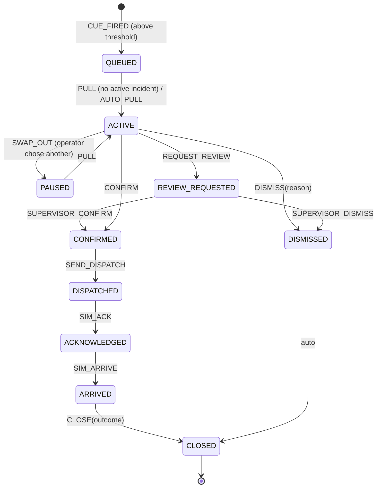
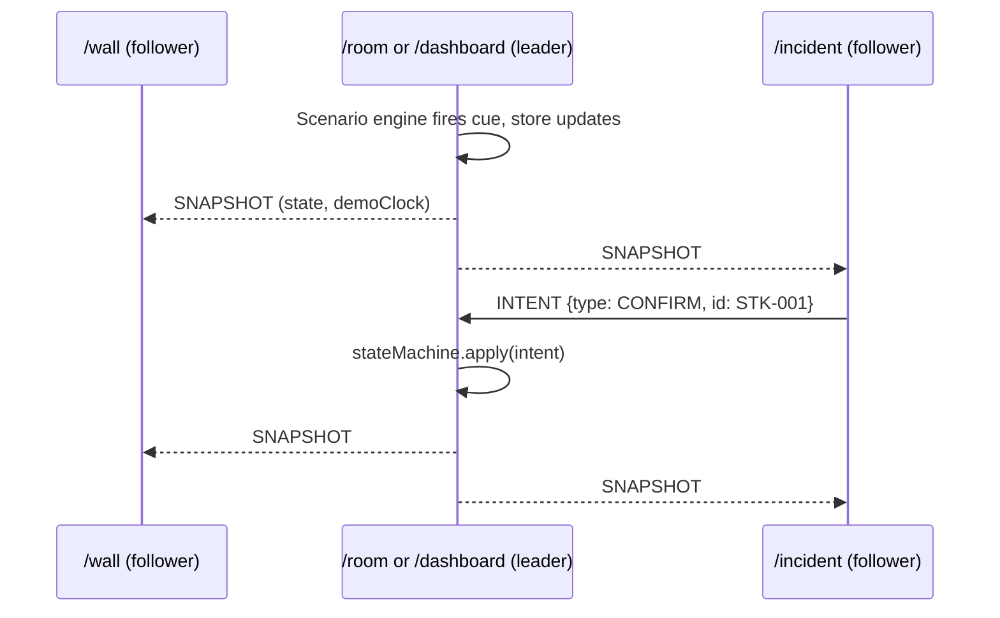

# architecture.md: SOTORKO AI Prototype Mock-up

> Companion to `design.md`. Defines the stack, modules, data schemas, the incident state machine and the multi-window sync design.
> Principle: **the whole system is a deterministic replay engine.** Pre-labelled videos plus a cue file in, UI state out. No ML, no backend, no network.

## 1. Stack

| Concern | Choice | Why |
|---------|--------|-----|
| Build/UI | Vite + React 18 + TypeScript (strict) | Fast dev loop, Claude Code is strong with it |
| Styling | Tailwind CSS with design tokens from `design.md` | Quick, consistent |
| State | Zustand (single store, plain reducers) | Simple, easy to test and to broadcast |
| Routing | React Router (`/`, `/room`, `/wall`, `/incident`, `/dashboard`, `/presenter`, `/summary`) | Satellite windows are just routes |
| Video | Native `<video>` elements, MP4/H.264, muted, `playsInline`, `loop` | No extra deps |
| Audio | Web Audio API (generated beeps) | No audio assets, works offline |
| Map | Inline SVG stylised map with fictional pins | Offline by default |
| Sync | `BroadcastChannel` | Same-origin multi-window, no server |
| Validation | Zod schemas for `clips.json`, `cameras.json`, `scenarios/*.json` | Fail fast on bad data |
| Tests | Vitest (unit), Playwright (one e2e) | Cover state machine and S3 |
| Packaging | `vite build` then any static server (`npx serve dist`) | Runs offline |

No backend. No database. Persistence is optional `localStorage` for the audit log and settings only.

## 2. System context

```mermaid
flowchart LR
  subgraph Assets["Static assets (public/)"]
    V[videos/*.mp4]
    D[data/clips.json\ncameras.json\nscenarios/*.json]
  end
  subgraph App["Browser app (leader window)"]
    L[Data loader + Zod]
    VW[Video Wall]
    SE[Scenario Engine\n(cue scheduler)]
    IS[Incident Store\n(state machine)]
    DS[Dispatch Simulator]
    AL[Alarm Service]
    AU[Audit Log]
    UI[Panels A / B / C\nPresenter]
  end
  V --> VW
  D --> L --> SE
  VW -- currentTime ticks --> SE
  SE -- CUE_FIRED --> IS
  IS --> UI
  IS --> AL
  IS --> DS --> IS
  IS --> AU
  UI -- operator intents --> IS
  IS <-- BroadcastChannel --> SAT[Satellite windows\n/wall /incident /dashboard]
```

## 3. Repository layout

```
sotorko-prototype/
  CLAUDE.md                     # rules for Claude Code (see phases.md, Phase 0)
  docs/ design.md architecture.md phases.md
  public/
    videos/                     # clips (git-ignored if large; manifest is committed)
    data/
      clips.json
      cameras.json
      map.json                  # SVG viewBox + camera x/y + street paths
      scenarios/ s1.json ... s6.json
  src/
    main.tsx  App.tsx  routes.tsx
    domain/                     # pure TypeScript, no React
      types.ts                  # shared interfaces (section 4)
      stateMachine.ts           # transitions + guards (section 5)
      lockRule.ts               # queue / pull-next logic
      priority.ts               # ordering
      cueScheduler.ts           # cue arming and firing (section 6)
      dispatchSim.ts            # timed simulated dispatch
      evidence.ts               # builds incident package JSON
    store/
      store.ts                  # Zustand store, reducers, selectors
      sync.ts                   # BroadcastChannel leader/follower
      persistence.ts            # audit log + settings
    services/
      alarm.ts                  # WebAudio alarm + queue tone
      clock.ts                  # demo clock with speed multiplier
      loader.ts                 # fetch + validate data files
    components/
      layout/ Banner Footer PanelShell
      wall/ VideoTile VideoWall
      incident/ IncidentScreen FeedView MiniMap FieldList Chips ClipStrip ActionBar DispatchSheet QueueBanner
      dashboard/ QueueTable IncidentDrawer Counters
      presenter/ PresenterPanel ScenarioPicker CueList
      supervisor/ SupervisorModal
      summary/ SummaryTable ExportButtons
    pages/ Start Room Wall Incident Dashboard Presenter Summary
    styles/ tokens.css
  tests/
    unit/ stateMachine.test.ts lockRule.test.ts cueScheduler.test.ts
    e2e/ s3-simultaneous.spec.ts
  scripts/
    validate-data.ts            # checks clips exist, cues inside duration, license present
    make-lowres.sh              # optional ffmpeg 480p copies
```

## 4. Data schemas (Zod mirrors these)

```ts
// domain/types.ts
export type Priority = "HIGH" | "MEDIUM" | "LOW";
export type GroundTruth = "crime_like" | "non_crime";

export interface Clip {
  id: string;                    // "clip_altercation_01"
  file: string;                  // "videos/altercation_01.mp4"
  durationSec: number;
  label: GroundTruth;            // ground truth for the summary only; never shown on B/C
  category: string;              // "physical_altercation" | "decoy_play_fight" | "plain_traffic" ...
  source: string;                // "staged by team" | "licensed: <name>"
  consent: boolean | "n/a";
  license?: string;
  notes?: string;
}

export interface Camera {
  id: string;                    // "CAM-07"
  label: string;                 // "Example public intersection A, Dhaka"
  mapX: number; mapY: number;    // on map.json viewBox
}

export interface Cue {
  cueId: string;                 // unique
  clipId: string;
  atSec: number;                 // fires when playback crosses this
  clipWindow: [number, number];  // seconds to show in "recent event clip"
  event: {
    type: string;                // "physical_altercation"
    title: string;               // "Possible physical altercation"
    confidence: number;          // 0..1, SCRIPTED
    priority: Priority;
  };
  box?: { x: number; y: number; w: number; h: number }[]; // % coords, optional keyframes
  truth: GroundTruth;            // equals clip label normally; decoys are non_crime
}

export interface Scenario {
  id: "S1" | "S2" | "S3" | "S4" | "S5" | "S6";
  name: string;
  tiles: { tileIndex: number; cameraId: string; clipId: string; startOffsetSec?: number }[];
  armedCueIds: string[];
  autoplay?: { steps: { atSec: number; action: "fireCue" | "operatorConfirm" | "operatorDismiss" | "closeIncident"; arg?: string }[] };
  settings?: { alertThreshold?: number; dispatchSpeed?: 1 | 5 | 10; autoPull?: boolean };
}

export type IncidentStatus =
  | "QUEUED" | "ACTIVE" | "PAUSED" | "REVIEW_REQUESTED"
  | "CONFIRMED" | "DISPATCHED" | "ACKNOWLEDGED" | "ARRIVED"
  | "CLOSED" | "DISMISSED";

export interface Incident {
  id: string;                    // "STK-001", sequential per session
  cueId: string; clipId: string; cameraId: string;
  title: string; eventType: string;
  confidence: number; priority: Priority;
  firedAtDemoMs: number;         // from demo clock
  firedAtWall: string;           // formatted for display (illustrative time)
  status: IncidentStatus;
  operator?: string;             // "Op. A"
  dismissReason?: string;
  dispatch?: { channel: string; unit?: string; steps: { status: string; atDemoMs: number }[] };
  outcome?: "Resolved" | "Handed over" | "No further action";
  truth: GroundTruth;            // hidden on B/C, shown in summary
  log: { atMs: number; actor: "system" | "operator" | "supervisor"; action: string; detail?: string }[];
}
```

`clips.json` and scenarios are authored by the team; `scripts/validate-data.ts` checks:
- every `clipId` and `file` exists, every cue `atSec` and `clipWindow` is within the clip duration;
- `source` is non-empty and `consent`/`license` is set for every clip used;
- cue IDs are unique, thresholded cues are above 0 and at most 1.

## 5. Incident state machine



Guards and invariants (enforced in `stateMachine.ts`, covered by unit tests):
- **I1 (lock):** at most one incident per operator has status `ACTIVE`. `CUE_FIRED` while an incident is `ACTIVE` can only produce `QUEUED`.
- **I2:** `CONFIRM`, `DISMISS`, `REQUEST_REVIEW` are legal only from `ACTIVE`.
- **I3:** `DISMISS` requires a reason string.
- **I4:** `SEND_DISPATCH` requires `CONFIRMED`. Dispatch steps are driven by `dispatchSim` using the demo clock.
- **I5:** `REVIEW_REQUESTED` frees the operator's lock, so the next queued incident can be pulled, but the incident stays visible on C, pinned with a `REVIEW REQUESTED` badge, until the supervisor decides.
- **I6:** a cue fires at most once per scenario run (`firedCueIds` set).
- **I7:** all transitions append to `incident.log` and the global audit log.

Pseudo-code for the lock rule:

```ts
function onCueFired(state, cue) {
  if (cue.event.confidence < state.settings.alertThreshold) return state;       // ignored
  const inc = newIncident(cue, state);                                          // status QUEUED
  const active = state.incidents.find(i => i.status === "ACTIVE");
  state = addIncident(state, inc);
  if (!active && state.settings.autoPull) return pull(state, nextQueued(state));
  return notifyQueued(state, inc);                                              // tone + banner only
}
const nextQueued = (s) => sortByPriorityThenAge(s.incidents.filter(i => i.status === "QUEUED" || i.status === "PAUSED"))[0];
```

## 6. Scenario engine and cue scheduler

Goal: fire cues **deterministically and exactly once** from video playback time.

- Each `VideoTile` reports `currentTime` to the engine using `requestVideoFrameCallback` when available, else `timeupdate` plus a 100 ms interval.
- The scheduler keeps, per tile, `lastTime`. A cue fires when `lastTime < cue.atSec <= currentTime` **and** `cue.cueId` is not in `firedCueIds`. This handles seeks, pauses and ticks that skip.
- **Loops:** tiles loop, but `firedCueIds` prevents re-firing. Optional scenario flag `rearmOnLoop` for S5/S6 demos.
- **Pause/speed:** a global `demoClock` (speed multiplier, pause) controls `video.playbackRate` and dispatch timers, so everything stays in step.
- **Fallback timer mode:** if videos fail, the scheduler can fire cues from `demoClock` using each cue's `atSec` as scenario time (so the workflow still demos). Presenter panel shows "TIMER MODE".
- **Autoplay script (S6):** an optional `autoplay.steps` list replays operator actions (`operatorConfirm`, etc.) by dispatching the same intents a human click would. This keeps one code path.

`FeedView` (incident screen) uses a second `<video>` bound to the same file and seeks to the alert tile's current time; if browsers drift, re-sync every 2 s. "Recent event clip" uses `video.currentTime = clipWindow[0]` with a pause at `clipWindow[1]`.

## 7. Multi-window sync (optional feature, route-level)



- Channel name `sotorko-sync-v1`. Leader election: first window to claim `leader` (with a heartbeat every 1 s); followers take over if heartbeats stop for 3 s.
- Followers render from snapshots and never run the scenario engine or dispatch sim. Videos in follower windows seek to `snapshot.clock` and play.
- Snapshots are plain JSON (state without functions). Send on each change, throttled to about 10/s; send the demo clock every 1 s for drift correction.
- Satellite routes take `?role=follower` implicitly; `/room` is always leader-capable.

## 8. Alarm service

- `alarm.start(priority)` plays a looping two-tone pattern (HIGH: 880/660 Hz every 1 s, MEDIUM: single 660 Hz every 3 s, LOW: none). `alarm.queueTone()` plays one short tone when an alert queues. `alarm.stop()` on first operator interaction with the active incident or the mute button.
- An `AudioContext` is created inside the **Start demo** click handler to satisfy autoplay policies. Store a flag `audioUnlocked`; if false show "Click to enable sound".

## 9. Map

`public/data/map.json` holds `viewBox`, simple street paths and landmark blocks drawn as SVG; `cameras.json` gives pin positions. `MiniMap` renders the street grid with the active camera pin highlighted (magenta, pulsing) and other cameras as small cyan dots. All labels carry `Example` prefixes and an `ILLUSTRATIVE MAP` tag. A Leaflet implementation can be added behind a feature flag in the stretch phase.

## 10. Evidence package (simulated)

`domain/evidence.ts` builds a JSON object for download:

```json
{
  "incidentId": "STK-001",
  "label": "SIMULATED, scripted detection on pre-labelled clip",
  "camera": "CAM-07",
  "clip": { "file": "videos/altercation_01.mp4", "window": [10.5, 22.0] },
  "event": { "title": "Possible physical altercation", "scriptedConfidence": 0.92, "priority": "HIGH" },
  "decision": { "actor": "operator", "action": "CONFIRM", "atDemoMs": 123456 },
  "dispatch": { "channel": "Police Control Room (SIMULATED)", "steps": [] },
  "log": []
}
```

No video bytes are copied; the package references the clip and time window.

## 11. Error handling and resilience

- Data load failures: show a full-screen error listing the failing file and the Zod issue.
- Video error event: tile turns into a "FEED OFFLINE" card (grey, CAM label, reconnect attempt every 10 s). A cue on an offline tile switches the engine to timer mode for that tile.
- Unhandled exceptions: React error boundary per panel so one panel can fail without taking the whole room down.
- Never `fetch` any external URL. Add a Vitest check or lint rule that greps `src/` for `http://` and `https://` (except comments and `localhost`).

## 12. Testing

- **Unit:** state machine transitions and invariants I1-I7; lock rule ordering; cue scheduler with simulated time ticks (seek, loop, skipped ticks, threshold); dispatch simulator timing at 1x/5x/10x.
- **Data:** `scripts/validate-data.ts` runs in CI and before `build`.
- **E2E (Playwright, one spec):** S3 simultaneous incidents; assert active incident unchanged when second cue fires, banner text appears, queue shows two rows, after dismiss the second becomes active.
- **Manual:** audio on Start click; 9 video playback performance; offline run with network disabled.

## 13. Performance notes

- Decode budget: 9 tiles at 720p; offer `*_480.mp4` copies automatically via `make-lowres.sh` and a `?lowres=1` flag.
- Pause videos in tabs that are hidden; do not mount follower videos in the leader when `/wall` is open in another window (optional optimisation).
- Keep the store updates coarse (incidents and settings); keep `currentTime` out of the store (refs and the scheduler only).

## 14. Security and privacy

- All media and data are local. No analytics, no external requests, no cookies.
- No personal data stored; `localStorage` holds only settings and the audit log, with a "Clear data" button.
- Document in `README.md` that the clips are staged or licensed (see `design.md` section 9) and who to contact about them.

## 15. Build and run

```bash
npm install
npm run validate:data      # checks clips and cues
npm run dev                # http://localhost:5173
npm run build && npx serve dist   # offline demo build
npm run test               # unit
npm run test:e2e           # Playwright (S3)
```
